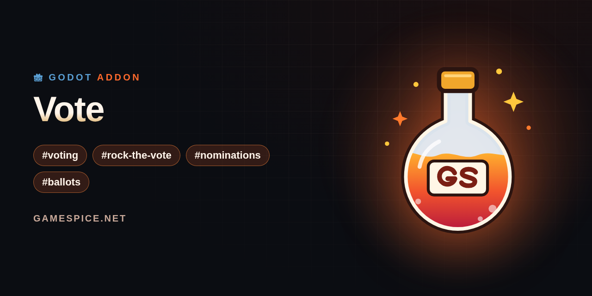

[](https://moddingcommunity.com/a/29-gs-vote)

Let players, rather than a rotation, decide what plays next: games, maps or modes. Rock the vote, nominations, per-choice time limits, a ballot and the change at the end of it. It is the familiar `rtv`, `nominate`, `mapchooser`, `timeleft`, `extend` shape, with every part a setting, so a community changes a number instead of forking it.

## Install

1. Get [Godot 4.7](https://godotengine.org/download).
2. Either use [GameSpice Bootstrap](https://github.com/gamespice-platform/bootstrap), which clones every project and links the addons, or copy `addons/dot_vote/` and [GameSpice Core](https://github.com/gamespice-platform/core)'s `addons/dot_core/` into your project and enable dot-vote in *Project > Project Settings > Plugins*.

GameSpice Core is the only dependency. [GameSpice Server](https://github.com/gamespice-platform/server) and [GameSpice Map](https://github.com/gamespice-platform/map) are optional and are reached without being imported.

## Use

```gdscript
var votes := DotVoteDirector.new()
votes.rules = DotVoteRules.new()
votes.source = DotVoteGameSource.of(server.games)   # or a map catalogue, or your own
votes.player_count_fn = func() -> int: return players.size()
add_child(votes)

votes.begin(&"lobby")        # what is running now

# once per tick
votes.advance(delta)
```

Everything else is configuration.

## What it does

| Feature | Detail |
| --- | --- |
| Rock the vote | A fraction of players, a minimum player count, a delay at the start of each map, one vote per player, withdrawn when they disconnect. |
| Nominations | Per-player and total limits, seconding, admin bypass, and reserved ballot places so a few organised players cannot decide every map. |
| Time limits | Seconds, rounds, score, or all three, per choice, with warnings and extending. |
| End-of-map vote | One switch (`end_vote`). The ballot opens a set lead before the end, with an optional countdown. "Extend" adds time, rounds and score. |
| The ballot | Options filled several ways, with "extend", "don't change" and "no vote" switchable, placed first or last, optionally shuffled, custom maps marked. |
| Counting | Plurality, approval, instant runoff or majority runoff. Quorums, weighted ballots, tie-breaks. |
| Cooldowns | In plays or minutes, per choice, kept from excluding the whole pool. |
| Applying | Immediately, at round end or when the clock runs out, with a delay so players can read the result. |
| Cues | Countdown signals and sound cue ids. The host plays them. |
| Commands | `nominate`, `rtv`, `votefor`, `timeleft`, `nextmap`, `revote`, `extend`, `endvote`, `setnextmap`, `nominate_addmap`, `forcertv`, `votereload` and more, on a GameSpice Server console and in chat. Names are configurable; admin ones need the `changemap` flag. |

## The pieces

| Class | What it is |
| --- | --- |
| `DotVoteRules` | Every policy decision, as one `DotConfig`: defaults, then file, then `DOT_VOTE_*`, then `--vote-*`. Enum settings are written by name (`method: instant_runoff`). |
| `DotVoteChoice` | One thing to vote for: id, name, player counts, its own time limit, cooldown and weight. |
| `DotVoteSource` | Where choices come from and what "play this" means. |
| `DotVoteDirector` | The `Node` that joins them, driven by `advance(delta)`. |
| `DotVoteClock` | The limit, warnings, extends and rock-the-vote. |
| `DotVoteClockView` | The clock as a client shows it. |
| `DotVoteBallot` | The open ballot and the counting methods. |
| `DotVoteBallotView`, `DotVoteBallotFeed` | The ballot as a client draws it, and a feed that sends it only when it changed. [GameSpice UI](https://github.com/gamespice-platform/ui)'s `DotBallotPanel` draws it. |
| `DotVoteNominations` | What players have asked for, in order. |
| `DotVoteHistory` | What has been played and what is on cooldown. |
| `DotVoteResult` | What was decided, and how, including which tie-break. |

## Choices

```gdscript
DotVoteGameSource.of(server.games)          # dot-server's games
DotVoteMapSource.of(catalogue, session)     # dot-map's maps
DotVoteListSource.of(my_choices)            # anything else, with a Callable
```

A list that changes while the server runs is better given as a function: `source.entries_fn = func() -> Array: return my_catalogue()` is read again when a map begins and before every ballot. It returns `DotVoteChoice`s, `[id, name]` pairs or bare ids.

`source.follow_content(DotContentIndex.shared(), PackedStringArray(["*"]))` adds the maps a player subscribed to (solo only). A server whose `maps.yml` lists only some maps sets `source.in_rotation_fn` so an unlisted map is never on the ballot or nominated.

Per-choice settings live in the thing's own metadata:

```yaml
# content/fc/game.yml
metadata:
  vote:
    time_limit_sec: 2400
    weight: 2.0
```

A source that cannot change anything is fine: the director runs the vote and emits `change_due` for the host to act on.

## Settings

Written as yml, JSON, environment or command line. A selection:

```yaml
trigger: time_limit          # round_end, or manual
duration_sec: 1800
end_vote: true
vote_lead_sec: 120           # the ballot opens two minutes before the end
vote_warning_sec: 10
warn_at_sec: "300,60,30"

include_extend: true
extend_seconds: 900
max_extends: 2

rtv_fraction: 0.6
rtv_min_players: 1
rtv_delay_sec: 120

max_options: 6
nomination_slots: 4
fill: least_recently_played
method: instant_runoff
tie_break: nomination_order
quorum: 0.4
on_no_quorum: keep

cooldown: 5
apply: end_of_round
apply_delay_sec: 5
```

An operator's file lives in `cfg/addons/dot_vote/vote.yml`, with `cfg/server/addons/dot_vote/` layered over it. Defaults you can see in code: `max_options` 6, `nomination_slots` 4, `max_extends` 3. [docs/parity.md](docs/parity.md) maps the settings, commands and hooks of the long-standing community map-chooser plugins onto these.

A game that builds its rules in code can layer an operator's file over them:

```gdscript
var rules := my_default_rules()
var layered := rules.layer_over_defaults(
    "user://cfg/my_game_vote.json",
    DotVoteGameSource.running_game_metadata("map_vote"),
)
```

A result that does not validate is refused whole, and the game keeps its own defaults.

## Testing

Import the project once, then run `examples/vote_selftest.tscn` headless with Godot. It runs against a real `DotGameManager` and `DotMapCatalogue` when GameSpice Server and GameSpice Map are linked in. Further notes: [docs/design.md](docs/design.md), [docs/history.md](docs/history.md).

## Status and licence

Part of the [**GameSpice**](https://gamespice.net) platform: a family of Godot addons. Written with Claude Code and maintained by `gamemann`. Every addon has headless tests, but little of this has been played by real users yet, so expect rough edges and please [open an issue](https://github.com/gamespice-platform/vote/issues) when you hit one.

MIT licence, see [LICENSE](LICENSE). The only closed part of the [**GameSpice**](https://gamespice.net) platform is the web back end; you can use your own instead of GameSpice's.
